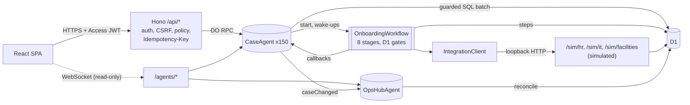

# OnboardFlow

An employee onboarding platform on Cloudflare Workers that coordinates setup across People Operations, IT and Facilities. Employees work a checklist, managers and People Ops approve at two checkpoints, and a durable workflow provisions accounts, devices, workspaces and badges through three **simulated** enterprise systems (HR, IT, Facilities). Coordination agents detect blockers, create follow-up tasks for the owning department, and keep live dashboards current. Every action lands in an append-only audit trail.

All 150 employees are synthetic. The HR, IT and Facilities systems are simulators that run inside the same Worker; nothing here talks to a real HRIS, identity provider, MDM or badge system.

What "agents" means here: `CaseAgent` and `OpsHubAgent` are [Cloudflare Agents SDK](https://developers.cloudflare.com/agents/) classes (Durable Objects with SQLite, schedules, WebSocket state sync and workflow callbacks). Their decisions come from a deterministic rule engine, not from an LLM. An LLM, when one is configured, only drafts the wording of follow-up tasks ([ADR 0004](docs/adr/0004-rules-decide-llm-drafts.md)): locally, in tests, CI and the evals the default is a deterministic stub; the production configuration drafts with Workers AI, capped at 20 calls per UTC day, and falls back to the template on any failure.

## What is in the box

- **Portal** (React 19, TypeScript, Vite): employee checklist with an 8-stage stepper, approvals, department queue, cases table, case detail with the audit trail, a live dashboard, integration health with per-case call logs, and an admin audit explorer. Four roles: employee, manager, coordinator (People Ops, IT or Facilities) and admin.
- **API** (Hono on Workers): every mutation requires `Idempotency-Key`, `X-OnboardFlow: 1` and a same-origin `Origin`, is checked against a role policy, and is written as a guarded D1 batch with its audit row ([ADR 0008](docs/adr/0008-guarded-mutations.md)).
- **Workflow** (Cloudflare Workflows): eight stages, retries with exponential backoff and Retry-After, polling of async resources, recovery rounds after a coordinator retries, two approval checkpoints with reject and resubmit (up to 3 rounds; an admin restart after the final rejection opens one more round), restart and terminate. Every wait is a D1 gate with a bounded timeout, so restarts and lost events cannot strand a case ([ADR 0002](docs/adr/0002-d1-gates-and-wake-up-events.md)).
- **Agents** (Agents SDK): one `CaseAgent` per employee (commands, wake-ups, blocker scans, follow-ups, read-only live state) and one `OpsHubAgent` (debounced reconcile of the dashboard from D1; a once-a-minute safety tick only while a dashboard is open).
- **Production tooling** (`scripts/prod`): an idempotent setup script for the Workers Free plan (D1, migrations, seed, logins, deploys, the Access application, policies and service token), a read-only doctor, and a verification script that drives a few cases through Access and measures CPU time per invocation ([Production setup](#production-setup-workers-free-plan)).
- **Simulated systems** under `/sim/*`: HR, IT and Facilities with idempotency keys honored atomically, async state machines, genuine validation errors, and injectable faults (503, 429 with Retry-After, timeout, lost response, malformed body, stall, desk conflict) ([ADR 0005](docs/adr/0005-loopback-simulated-systems.md)).
- **Auth**: Access-compatible RS256 JWT verification with `jose` (issuer and audience enforced; `exp` and `iat` required; the identity is the `email` claim, or `service-token:<client id>` for an Access service token, which grants nothing until provisioned), not yet exercised against a real Cloudflare Access application or team JWKS. Locally, the same verifier runs against a generated key and a persona picker ([ADR 0003](docs/adr/0003-hostname-access-jwt-verification.md)).
- **Eval suite**: 60 scripted scenarios (20 onboarding, 24 integration failures, 16 recovery), a 150-employee scale run, a chaos mode (5 seeds of seeded faults and outages worked by generic policy bots), two ablations and an optional local-LLM run, all driven over HTTP as the real personas against `wrangler dev`.

## Architecture



Design decisions are recorded in [docs/adr](docs/adr) and the domain vocabulary in [CONTEXT.md](CONTEXT.md). The full build specification, including every API fact it relies on and how it was verified, is [SPEC.md](SPEC.md).

## Local versus production

| Concern | Local (this machine, and GitHub Actions for the published copy) | Production (after deploy) |
|---|---|---|
| Worker runtime | workerd via `vite dev`, `wrangler dev` on the build, and `@cloudflare/vitest-plugin` (Miniflare) | Cloudflare Workers |
| Front end | Vite dev server, or `dist/client` served by local assets | Workers static assets with SPA fallback |
| Plan | n/a | Workers Free (no Workers Paid), Zero Trust Free; see [Workers Free plan](#workers-free-plan) |
| D1 | local SQLite under `.wrangler/state` or a `--persist-to` directory | D1 `onboardflow-prod` |
| Agents (Durable Objects, SQLite) | local Durable Objects | Durable Objects |
| Workflows | local Workflows engine; restart wipes delivered events (D1 gates make this harmless) | Cloudflare Workflows; restarting a terminated instance is unverified, so a new-revision fallback covers it |
| Auth | `AUTH_MODE=dev`: RS256 JWT minted by `/dev/login` with a locally generated key, verified by the same code as production; persona picker | `AUTH_MODE=access`: self-hosted Access application `onboardflow` on `onboardflow-production.nitish-ratakonda.workers.dev` (One-time PIN, the owner and five plus-address personas; Service Auth for the verification token), `Cf-Access-Jwt-Assertion` verified against the team's JWKS with `iss` and `aud`. Until the AUD is configured every route fails closed with 500 `config_placeholder` |
| CSRF defenses | Origin + `X-OnboardFlow` + required `Idempotency-Key`; dev cookie `SameSite=Strict` | same checks; Access cookie set to `SameSite=Lax`, HttpOnly |
| Secrets | `.dev.vars` from `npm run dev:keys`; tests use Miniflare bindings; evals generate a fresh set per run | `SIM_API_KEY` generated by the setup script and uploaded with the first deploy; the verification service token in `~/.config/onboardflow/production-service-token.json` (0600, outside the repository) |
| LLM (follow-up wording only) | deterministic stub (default), or an OpenAI-compatible server such as llama-server with Qwen3-1.7B Q4_0 | Workers AI `@cf/qwen/qwen3-30b-a3b-fp8`, no AI Gateway, at most `LLM_DAILY_DRAFT_LIMIT` (20) calls per UTC day, then the template (built and tested with a fake binding; never run against Cloudflare) |
| HR, IT, Facilities | **simulated**, same Worker, `/sim/*` | **still simulated**, same Worker, `/sim/*` |
| Clock | real, or an offset clock with `SIM_CLOCK=on` (evals and tests) | real only |
| Fault injection, eval hooks, eviction route | `EVAL_HOOKS=on` in eval runs | off; the routes answer 404 |
| Eval suite | runs here against `wrangler dev` | not run (it needs the hooks and the simulated clock) |

The deployment to Cloudflare has not been done yet. It is scripted (`npm run prod:setup`, below) and the script's dry run has been checked against the account with read-only calls, but nothing has been created or deployed; until it runs, everything in this README was run locally (workerd through Miniflare and `wrangler dev`).

CI: the copy of this repository published on GitHub runs `.github/workflows/ci.yml` in [GitHub Actions](https://github.com/nitishsjsucs/onboardflow/actions) on every push, on Node 24 (required) and Node 25 (allowed to fail), on ubuntu: typegen and seed checks, typecheck, tests, build, the standard eval with its CI gate, and a production deploy dry run. That copy is a rewrite of this history (different commit SHAs, no co-author trailers), and it was not pushed from this repository; [eval/results/published-sha-map.json](eval/results/published-sha-map.json) maps this history's SHAs to the published ones. Between 2026-10-08 23:14 UTC and 2026-10-09 20:32 UTC it ran 19 times: 14 green and 5 red. One red run (Node 24) came from an intermittent test race, fixed in the test since; in one green run the allowed-to-fail Node 25 job was red, from a hub debounce race fixed in the product since; both are described in PROGRESS.md under "Known noise". The other 4 red runs (2026-10-09 18:24 to 19:10 UTC) came from the SHA rewrite made for publishing, which changed the expected strings of two tests in `test/node/eval-metrics.test.ts` but not the fixture SHAs they derive from; those fixtures now use synthetic SHAs that no rewrite touches, and main has been green since that change was published (19:30 UTC), on both Node versions, with the current `ci.yml` (read-only token, actions pinned by commit SHA).

## Run it locally

Requirements: npm and Node. Developed and tested on Node 25.9 (macOS); GitHub Actions has run the checks of the published copy on Node 24 and 25 (ubuntu). `engines` allows 22.18 or later, but Node 22 has not been run.

```sh
npm ci
npm run dev:keys          # writes .dev.vars: a local RS256 key pair and SIM_API_KEY
npm run db:reset:local    # applies the D1 migrations and the committed synthetic seed
npm run dev               # Vite dev server with the Worker in workerd
```

Open the printed URL, pick a persona on the login page (three employees, three managers, one coordinator per department, two admins), start a case from **Cases** as the People Ops coordinator, and follow it through the employee portal, the approvals page and the live dashboard.

To serve the production-like build instead: `npm run build && npm run serve:local` (wrangler dev on the built Worker).

To see the dashboards with something on them, the demo driver fills the local state with a seeded mix of cases: it resets `.wrangler/state`, applies the migrations and the seed, starts `wrangler dev` on the build, pins the simulated clock, and drives all 150 employees over HTTP as the personas. Its seeded plan completes 42 cases and holds the rest in each of the eight stages: 24 each at the four human checkpoints (paperwork, manager approval, orientation, closeout approval), and 3 each at intake, IT, Facilities and provisioning verification, where only a simulated outage (a sustained 503 for that one employee) can hold a case, so those 12 show real integration blockers. At the end the driver reads every case back over the API, prints the mix it observed and exits non-zero if any case is not where the plan put it. Then `npm run serve:local` serves that state (on the real clock, without the eval hooks).

```sh
npm run build && npm run dev:keys
npm run demo:drive            # --port and --inspector-port if 8787/9229 are taken, --seed to reshuffle
npm run serve:local
```

### Checks

```sh
npm run typecheck       # strict TypeScript: worker, web and node projects
npm test                # vitest: worker tests inside workerd, node tests, web tests (happy-dom)
npm run build           # vite build + check that Agent class names survive bundling
npm run seed:check      # the committed seed is byte-identical to the generator
npm run typegen:check   # worker-configuration.d.ts matches wrangler.jsonc
npm run deploy:dry-run  # production bundle without credentials (run `npm run build` again afterwards)
```

### Eval

```sh
npm run build
npm run eval:ci       # 60 scripted scenarios, CI gate
npm run eval:scale    # all 150 synthetic employees, no faults
npm run eval:chaos    # 60 employees x 5 seeds, seeded faults and policy bots (about 20 minutes)
npm run eval:ablate   # the 60 scenarios with Idempotency-Key handling off, then with retries off
npm run eval:llama    # standard mode with llama-server (Qwen3-1.7B Q4_0, port 8110) drafting follow-up wording
npm run llm:smoke     # one structured-output request against the local llama-server
```

The harness creates a fresh local D1 per run (migrations and the committed seed), generates fresh secrets into that run's own `.dev.vars`, starts `wrangler dev` (port 8781 by default, `--port` to change), pins the simulated clock to 2026-10-08 (the seed's reference date, so results do not drift with the calendar), and plays each scenario over HTTP as the real personas. Results are written to `eval/results/`.

Read the standard numbers for what they are: every scenario is designed so a correct system finishes the case, with failures recovered automatically (retries, idempotent replay) or by the scripted action a real coordinator would take. Standard mode is therefore a regression suite (CI requires 60/60), not an estimate of completion under uncontrolled conditions.

The two ablations rerun the same scenarios with one mechanism switched off (Idempotency-Key handling in the simulated systems, or step retries), to show that the mechanism, not luck, produces the standard results.

Chaos mode is the informative measurement: `npm run eval:chaos` runs the same 60 employees for 5 seeds, each on a fresh local D1 and server, with no per-scenario script. A seeded injector faults about 30% of (employee, operation) pairs (some beyond the retry budget), opens 0 to 2 sustained outage windows of 10 to 60 s per system, and corrupts validated fields; generic seeded bots play the employees, managers, the three department coordinators and an admin, acting only on what the API shows them. Each case has 180 s: it counts as completed only if a poll saw it `complete` within that time, and the bots stop working a case once its deadline passes. The coordinator bots give up after 3 retries of one blocker, but the workflow's own limit comes first: a blocker stays open across rounds, so its third retry starts a stage's fourth round at the earliest, which is the last one, and if that round fails the workflow fails the case (at most 4 rounds per stage and 6 per case). So "bot patience" is 0 by construction, and the limit that applies is the workflow's recovery-round cap. The fault table and policies are in `eval/harness/policies.ts`; decisions taken before the first recorded run, and the trial runs behind them, are logged in `eval/results/CHANGELOG.md`.

## Results

Everything below is rendered by `npm run results:readme` from `eval/results/latest-*.json`, the files the harness wrote, unedited in this repository; a test fails if this block drifts from them. (The copy published on GitHub rewrote the commit SHA fields of every `eval/results` file to point at its own history, in its commit d6df50f; the map above resolves them.) Runs from 2026-10-09 19:00 UTC on also record which build they served: the harness refuses a build that is not from the commit the run starts at, and hashes `dist/` at the start and end of the run. These are local measurements on `wrangler dev` (Miniflare/workerd) on a laptop, with the simulated systems and the stub LLM provider (except the one run labeled as using a local LLM), not production numbers; production verification results, once recorded, go to `eval/results/production/`. Standard mode is the regression suite described above: its completion rate is close to guaranteed by construction and is not a measure of how often onboarding succeeds under uncontrolled failures.

<!-- results:start -->
#### Standard mode (regression suite, scripted recovery)

Command `node eval/harness/run.ts --mode standard --llm stub --gate ci` (via `npm run eval:ci`), run 2026-10-15 (git 08ab031 at start, clean tree, built from that commit, dist/ unchanged during the run), provider `stub`, local wrangler dev (Miniflare/workerd), concurrency 6.

| Metric | Value |
|---|---|
| Cases started | 60 |
| Completed | 60/60 (100.0%) |
| Passed (completed and every expectation held) | 60/60 |
| onboarding | 20/20 passed |
| integration failure | 24/24 passed |
| recovery | 16/16 passed |
| Integration calls (retried, replayed) | 1281 (60, 27) |
| Duplicate side effects in the simulated systems | 0 |
| Harness requests retried after a dropped local proxy connection (still failed) | 0 (0) |
| Audit coverage (regression check) | 1 |
| Live hub equals D1 reconcile after the run | yes |
| Scenario time p50 / p95, wall time | 23.9 s / 32.6 s, 241 s |
| Host stalls over 5 s (system sleep or a frozen harness) | none |

#### Standard mode with a local LLM drafting follow-up wording

Command `node eval/harness/run.ts --mode standard --llm llama` (via `npm run eval:llama`), run 2026-10-15 (git 08ab031 at start, clean tree, built from that commit, dist/ unchanged during the run), provider `llama (openai:qwen3-1.7b, Qwen3-1.7B Q4_0)`, local wrangler dev (Miniflare/workerd), concurrency 6.

| Metric | Value |
|---|---|
| Cases started | 60 |
| Completed | 60/60 (100.0%) |
| Passed (completed and every expectation held) | 60/60 |
| onboarding | 20/20 passed |
| integration failure | 24/24 passed |
| recovery | 16/16 passed |
| Integration calls (retried, replayed) | 1280 (60, 27) |
| Follow-ups drafted by the LLM (schema-valid / attempted) | 20 created, 70.0% valid, category agrees with the rules 100.0%, p50 4652 ms |
| Duplicate side effects in the simulated systems | 0 |
| Harness requests retried after a dropped local proxy connection (still failed) | 0 (0) |
| Audit coverage (regression check) | 1 |
| Live hub equals D1 reconcile after the run | yes |
| Scenario time p50 / p95, wall time | 23.7 s / 41.6 s, 267 s |
| Host stalls over 5 s (system sleep or a frozen harness) | none |

#### Chaos mode (seeded faults and policy bots, 5 seeds)

Command `node eval/harness/run.ts --mode chaos --llm stub --seeds 5` (via `npm run eval:chaos`), run 2026-10-15 (git 08ab031 at start, clean tree, built from that commit, dist/ unchanged during the run), provider `stub`, local wrangler dev (Miniflare/workerd), concurrency 10.

| Metric | Value |
|---|---|
| Cases started | 300 |
| Completed | 287/300 (95.7%) |
| Completion per seed (mean, min, max) | 95.7%, 93.3%, 98.3% |
| Seed 1 | 57/60; not completed: 0 failed, 0 bot patience, 3 deadline; harness: 0 transport retries, 0 control retries, 0 bot request errors |
| Seed 2 | 57/60; not completed: 0 failed, 0 bot patience, 3 deadline; harness: 0 transport retries, 0 control retries, 0 bot request errors |
| Seed 3 | 59/60; not completed: 1 failed, 0 bot patience, 0 deadline; harness: 0 transport retries, 0 control retries, 0 bot request errors |
| Seed 4 | 58/60; not completed: 0 failed, 0 bot patience, 2 deadline; harness: 0 transport retries, 0 control retries, 0 bot request errors |
| Seed 5 | 56/60; not completed: 0 failed, 0 bot patience, 4 deadline; harness: 0 transport retries, 0 control retries, 0 bot request errors |
| Integration calls (retried, replayed) | 9981 (4183, 96) |
| Duplicate side effects in the simulated systems | 0 |
| Harness requests retried after a dropped local proxy connection (still failed) | 0 (0) |
| Audit coverage (regression check) | 1 |
| Live hub equals D1 reconcile after the run | yes |
| Scenario time p50 / p95, wall time | 105.3 s / 170.4 s, 957 s |
| Host stalls over 5 s (system sleep or a frozen harness) | none |

#### Scale mode (all 150 synthetic employees, no faults)

Command `node eval/harness/run.ts --mode scale --llm stub` (via `npm run eval:scale`), run 2026-10-15 (git 08ab031 at start, clean tree, built from that commit, dist/ unchanged during the run), provider `stub`, local wrangler dev (Miniflare/workerd), concurrency 10.

| Metric | Value |
|---|---|
| Cases started | 150 |
| Completed | 150/150 (100.0%) |
| Integration calls (retried, replayed) | 2850 (0, 0) |
| Duplicate side effects in the simulated systems | 0 |
| Harness requests retried after a dropped local proxy connection (still failed) | 5 (0) |
| Audit coverage (regression check) | 1 |
| Live hub equals D1 reconcile after the run | yes |
| Scenario time p50 / p95, wall time | 25.0 s / 30.3 s, 385 s |
| Host stalls over 5 s (system sleep or a frozen harness) | none |

#### Ablation: Idempotency-Key handling switched off in the simulated systems

Command `node eval/harness/run.ts --mode ablation-idempotency`, run 2026-10-15 (git 08ab031 at start, clean tree, built from that commit, dist/ unchanged during the run), provider `stub`, local wrangler dev (Miniflare/workerd), concurrency 6.

| Metric | Value |
|---|---|
| Cases started | 60 |
| Completed | 60/60 (100.0%) |
| Passed (completed and every expectation held) | 50/60 |
| onboarding | 20/20 passed |
| integration failure | 18/24 passed |
| recovery | 12/16 passed |
| Integration calls (retried, replayed) | 1300 (60, 0) |
| Duplicate side effects in the simulated systems | 28 |
| Harness requests retried after a dropped local proxy connection (still failed) | 0 (0) |
| Audit coverage (regression check) | 1 |
| Live hub equals D1 reconcile after the run | yes |
| Scenario time p50 / p95, wall time | 2.8 s / 10.3 s, 45 s |
| Host stalls over 5 s (system sleep or a frozen harness) | none |

#### Ablation: step retries switched off (RETRY_LIMIT=0)

Command `node eval/harness/run.ts --mode ablation-retries`, run 2026-10-15 (git 08ab031 at start, clean tree, built from that commit, dist/ unchanged during the run), provider `stub`, local wrangler dev (Miniflare/workerd), concurrency 6.

| Metric | Value |
|---|---|
| Cases started | 60 |
| Completed | 44/60 (73.3%) |
| Passed (completed and every expectation held) | 43/60 |
| onboarding | 19/20 passed |
| integration failure | 9/24 passed |
| recovery | 15/16 passed |
| Integration calls (retried, replayed) | 1013 (25, 23) |
| Duplicate side effects in the simulated systems | 0 |
| Harness requests retried after a dropped local proxy connection (still failed) | 0 (0) |
| Audit coverage (regression check) | 1 |
| Live hub equals D1 reconcile after the run | yes |
| Scenario time p50 / p95, wall time | 3.8 s / 62.0 s, 210 s |
| Host stalls over 5 s (system sleep or a frozen harness) | none |
<!-- results:end -->

**Reading these results.** Dates in the block are UTC. Every run shown was made by the finishing round on 2026-10-15 between 13:45 and 14:22 PDT, in a fresh clone of this repository at 08ab031 (`git clone`, `npm ci`, `npm run build`, then each eval command as documented above, one after another, the results moved out of the clone between runs so each started on a clean tree). 08ab031 carries every product change of this round (the license bundle lock race fix, the stage-start rule for checklist tasks, `agents` 0.28.1, the Free plan changes to the hub and the LLM cap); the commits after it change only the production scripts and docs. The laptop was on AC power with the lid open, but three other repositories were running their test suites at the same time: the load average (sampled every 30 s) was 37 to 110 during the standard run, 23 to 40 during the local-LLM run, 5 to 22 during the scale run, 2.4 to 5.1 during the ablations and 1.6 to 6.3 during the chaos run. No run had a host stall. At the heaviest load (the standard, local-LLM and scale runs) a scenario took about eight times longer than at load 2 (standard p50 23.9 s against 2.8 s on 2026-10-09); every one still finished within its deadline. All runs, including the ones not shown, are committed in `eval/results/`, and every change between runs is logged in [eval/results/CHANGELOG.md](eval/results/CHANGELOG.md).

- **Which code each run measured.** Every mode was re-recorded at 08ab031. Earlier runs of each mode are committed too; the runs of 2026-10-09 and 2026-10-10 predate this round's fixes.
- **Standard** completed and passed 60 of 60 with 0 duplicate side effects, and the CI gate passed, including O07 in its new form (the employee's early attempts are refused with 409 `stage_not_started`, nothing recorded). All seven committed standard runs with the stub provider (git 04ac941 to 08ab031) completed and passed 60 of 60.
- **Local LLM** (`npm run eval:llama`): the same 60 scenarios with llama-server running Qwen3-1.7B Q4_0 on the laptop's GPU drafting the wording of every follow-up. **60 of 60 completed and passed**, including F-it-validation, which failed in the previous local-LLM run (git 0503d3e, 59 of 60) because of the license bundle lock race fixed in e8136cb. 14 of the 20 follow-ups were drafted by the model (p50 4.7 s, 3.0 to 7.4 s) and 6 fell back to the template (F-hr-validation, F-hr-outage, F-hr-stall, R01, R11, R13); the results file does not record their error text. The previous run, at load 2, had all 20 drafted with a p50 of 1.2 s; this one ran at load 23 to 40 against a single-slot llama-server, and the successful drafts came close to the drafter's 8 s timeout, so that timeout is the likely cause, not verified. Read the 100% category agreement as "the drafting path works end to end", not as model quality: llama-server constrains the output to the JSON schema, whose category field is an enum, and the prompt names the blocker kind the rules already decided. The model never decides anything ([ADR 0004](docs/adr/0004-rules-decide-llm-drafts.md)), and the run does not measure whether its wording is better than the template's.
- **Chaos** is the informative number. This run completed 287 of 300 (per-seed 57, 57, 59, 58, 56: mean 95.7%, min 93.3%, max 98.3%) with 0 duplicate side effects and 0 retried harness requests, at a load average of 1.6 to 6.3. Of the 13 cases not completed, 12 missed the 180 s deadline (7 still in IT, Facilities or orientation, 5 at closeout) and 1 failed: seed 3's E059 used up the workflow's bounded recovery rounds at Facilities (`recovery_rounds_exhausted`), as in the chaos runs at c04aeb7, 676a939, d90973f, ea190b8 and 0503d3e (not at 6248014). The previous run (git 0503d3e, before this round's fixes) recorded the same per-seed counts; its misses split 6 and 6. On this shared laptop chaos moves with load and sleep: the second review round's code recorded 265 of 300 at load average 16 to 20 (git 676a939), 215 of 300 when the load reached 11 to 15 during seed 5 (git d90973f), and 180 of 300 in a run that overlapped clamshell sleep and is flagged as invalid (git ea190b8).
- **Earlier chaos runs** (the first four, before the deadline rule) counted completion differently: the harness read it from a snapshot taken after the whole seed finished, and the bots kept working cases past their deadline, so a case that completed after its deadline was counted. An independent review found this; the fix and what each old run counted are in the CHANGELOG. They reported 230, 210, 280 and 287 of 300; the first two each led to a harness fix (the orchestrator retries its own control calls; the harness retries a request dropped by `wrangler dev`'s local proxy with the same Idempotency-Key). Fault tables, seeds and bot policies did not change in any chaos run.
- **Scale** completed 150 of 150 with 0 duplicate side effects and a consistent hub. Of the earlier scale runs, one (git f5c8cfb) completed 148 of 150 after two harness requests got a plain-text 500 from the local runtime; the others completed 150 of 150.
- **Ablations** show what each mechanism buys. With Idempotency-Key handling off in the simulated systems, retried and replayed calls produced 28 duplicate side effects (0 in standard mode): all 60 cases completed, but 10 failed their exactly-once expectations. With step retries off, 16 cases stayed blocked where a fault needed a step retry (44 of 60 completed, 43 passed), with 0 duplicates. Every earlier ablation run gave the same retries-off result (44 of 60 completed, 43 passed); with keys off they recorded 27 or 28 duplicates (and 59 of 60 completed in a run that overlapped system sleep); R06 restarts a case while its old workflow instance is still running, so how far that instance gets before it is terminated varies by a step between runs.

## Production setup (Workers Free plan)

Nothing below has created or deployed anything yet; only the setup's dry run has been run against the account (read-only calls). The account facts are in `scripts/prod/settings.ts`: account `dc93c3bc8aa4f9e09a0d7e7354a80873`, workers.dev subdomain `nitish-ratakonda`, Zero Trust team `https://old-truth-a7dc.cloudflareaccess.com` (Free), the existing One-time PIN identity provider `743683e8-42d4-44e9-9991-ba57a1bb0dec`, owner `nitishsancs@gmail.com`. Every resource the scripts create is named `onboardflow*`: Worker `onboardflow-production`, D1 `onboardflow-prod`, Workflow `onboardflow-onboarding-prod`, Access application `onboardflow`, reusable policies `onboardflow-people` and `onboardflow-verification`, service token `onboardflow-verification`.

Before the first run:

1. `npx wrangler login` (wrangler always uses its OAuth login: the scripts remove `CLOUDFLARE_API_TOKEN` and similar variables from wrangler's environment; never export them).
2. An account API token for the Access calls, passed as `CF_API_TOKEN` for the one command: `Access: Apps and Policies Write` and `Access: Service Tokens Write`; optionally `Access: Organizations, Identity Providers, and Groups Read` (the preflight checks the team domain and the One-time PIN provider, and only warns without it) and `Account Analytics Read` (the GraphQL read-back of `prod:verify`). No identity provider write permission is needed: the provider is only referenced.

```sh
CF_API_TOKEN=... npm run prod:setup -- --dry-run   # prints every step; reads only (whoami, d1 list, secret list, Access GETs)
CF_API_TOKEN=... npm run prod:setup                # creates or converges everything below
npm run prod:doctor                                # read-only health check (CF_API_TOKEN optional)
CF_API_TOKEN=... npm run prod:verify               # drives 3 cases through Access and measures CPU time
```

What `prod:setup` does, in order; each step reads first and changes only what is missing or different, so a second run changes nothing except that it deploys again:

1. Preflight: wrangler is logged in with access to the account; `CF_API_TOKEN` is active; the Zero Trust team domain and the One-time PIN provider are the expected ones.
2. D1: creates `onboardflow-prod` (location hint `wnam`) unless it exists, refusing if the account already has the Free plan's 10 databases, and writes its id into `wrangler.jsonc`.
3. Applies pending migrations to the remote database.
4. Loads `seed/seed.sql` if the database is empty (`--seed-file` for a date-shifted copy), then upserts the logins: `nitishsancs@gmail.com` admin (own staff row), `+hr`, `+it`, `+facilities` as the seed's People Ops, IT and Facilities coordinators (C01, C03, C05), `+manager` as manager M01, and `+employee` as employee E014 (who reports to M01).
5. Bootstrap deploy while the Access AUD is still unknown: `predeploy-check --bootstrap`, the production build and `wrangler deploy`. The Worker fails closed: every Worker route (`/api/*`, `/agents/*`, `/sim/*`) answers 500 `config_placeholder` until the AUD is configured; only the static SPA shell, which holds no data, is reachable until the Access application exists a minute later. The first deploy uploads a generated `SIM_API_KEY` through a temporary 0600 secrets file (wrangler requires that for a new Worker with required secrets).
6. Access, with `CF_API_TOKEN`: the service token (its secret is shown once, so it is saved to `~/.config/onboardflow/production-service-token.json`, 0600, and rotated if that file is missing), the reusable policies (Allow for the six emails; Service Auth for the token), and the self-hosted application for `onboardflow-production.nitish-ratakonda.workers.dev` with only the One-time PIN provider, SameSite=Lax and HttpOnly cookies and a 24 hour session. Hostname-based, not the Worker's Access tab, because Worker-level Access refuses WebSocket upgrades ([ADR 0003](docs/adr/0003-hostname-access-jwt-verification.md)); `preview_urls` is off so no other hostname reaches the Worker.
7. Provisions the token's identity `service-token:<client id>` as an admin in D1 (and retires any earlier token's).
8. Writes the application's AUD into `wrangler.jsonc` and deploys again with `predeploy-check` in strict mode.
9. Smoke test: an unauthenticated request is stopped by Access, and the service token reaches `/api/me` as the admin.
10. Rebuilds the dev bundle, which the production build replaced.

Afterwards commit `wrangler.jsonc` (the database id and the AUD are not secrets). `npm run deploy` deploys later changes; it refuses any placeholder.

`prod:verify` acts as the admin principal of the service token. It takes the first not-started cases of the reserved employees E141 to E150 (at most 5 per run, default 3), drives one of them (default; at most 3) through the data issue path (IT refuses a license bundle, the CaseAgent opens a blocker and drafts one follow-up with Workers AI, the script restores the bundle and retries, as F-it-validation does locally), and the others through the happy path. While the cases run, `wrangler tail --format json` records every invocation's CPU time, outcome and exceptions; the script compares them with the Free limits per kind of invocation, counts each workflow instance's steps, prices the drafts in neurons from their token counts, reads the Workers and D1 analytics of the run's window when `CF_API_TOKEN` has Account Analytics Read, and writes everything to `eval/results/production/verify-<time>.json`. It exits non-zero if a case does not complete, an invocation is over its CPU limit, or a subrequest-limit error appears. The driver it uses is tested against the real Worker in workerd (`test/worker/prod-verify-driver.test.ts`).

Each persona is its own Access user, so each uses one of the Zero Trust Free plan's 50 seats on first login; the service token uses none. The committed seed is anchored at 2026-11-02; for a demo after that, generate a date-shifted copy (`npm run seed:generate -- --anchor <next Monday> --out seed/seed.demo.sql`) and pass `--seed-file seed/seed.demo.sql` to a setup run against an empty database.

## Workers Free plan

Production runs on the Workers Free plan (no Workers Paid), on an account shared with three other apps, so every daily allowance below is shared too. Each limit was read on developers.cloudflare.com on 2026-10-15 (page dates in brackets). Where a number can only be known in production, `npm run prod:verify` measures it instead of this README asserting it.

| Feature | Free limit | Source | This app | Verdict |
|---|---|---|---|---|
| Worker CPU per HTTP request | 10 ms | [Workers limits](https://developers.cloudflare.com/workers/platform/limits/#cpu-time) [Oct 12] | API handlers verify an RS256 JWT (WebCrypto), validate with zod and wait on D1 and Durable Object calls (waiting is not CPU). The simulators answer the workflow's loopback calls. | Expected to fit; not measurable locally. `prod:verify` records `cpuTime` of every invocation from `wrangler tail` and fails on any over its limit. |
| Workflow CPU per step | 10 ms | [Workflows limits](https://developers.cloudflare.com/workflows/reference/limits/) [Sep 21] | Each step is one guarded D1 batch and at most one loopback call to a simulator. | Expected to fit; measured by `prod:verify` (per invocation, an upper bound per step). |
| Durable Object CPU | 30 s per request, both plans | [Durable Objects limits](https://developers.cloudflare.com/durable-objects/platform/limits/) [Jun 1] | Scans, projections, hub reconciles. | Fits; measured too. |
| Subrequests per invocation | 50 external, 1,000 to Cloudflare services; D1 states 50 queries per invocation | [Workers limits](https://developers.cloudflare.com/workers/platform/limits/#subrequests), [changelog 2026-02-11](https://developers.cloudflare.com/changelog/post/2026-02-11-subrequests-limit/), [D1 limits](https://developers.cloudflare.com/d1/platform/limits/) [Apr 21] | The only external fetch is the Access JWKS (cached per isolate). An API request makes a few D1 queries (batches) and one Durable Object call; a workflow step one batch and one loopback call. A happy-path case makes about 19 simulator calls in total. | Expected to fit; a "Too many subrequests" error would fail a step, which `prod:verify` would show as an unexpected block and counts in the tail exceptions. |
| Requests per day | 100,000 per account, Workers and Workflow executions together; static assets free | [Workers limits](https://developers.cloudflare.com/workers/platform/limits/#daily-requests), [Workflows pricing](https://developers.cloudflare.com/workflows/reference/pricing/), [Workers pricing](https://developers.cloudflare.com/workers/platform/pricing/) [Oct 2] | Idle: none (no cron, nothing polls). The verification of 3 cases makes on the order of a thousand requests. | Fits. |
| Workflows steps | 1,024 per instance; 3,000 per day per account | [Workflows limits](https://developers.cloudflare.com/workflows/reference/limits/), [Workflows pricing](https://developers.cloudflare.com/workflows/reference/pricing/) | Worst case 561 per instance (asserted by `test/node/step-budget.test.ts`); a happy path about 70 (an estimate from the budget's parts: 3 frame, 32 stage, 1 checklist, 12 operation, 7 poll and 8 gate steps, plus a few waits). | Fits for a handful of cases a day; the 3,000 steps a day allow roughly 40 cases a day across the account, so the 150-employee demo driver is for local use only. `prod:verify` counts each instance's steps. |
| Workflows concurrency, retention, storage, script size | 100 running instances; 3 days; 1 GB-month; 3 MB | [Workflows limits](https://developers.cloudflare.com/workflows/reference/limits/) | Waiting instances do not count. Instances are created without a retention option. The bundle is 2,224 KiB uncompressed (`deploy:dry-run`). | Fits. |
| Durable Objects | SQLite-backed only; 100,000 requests, 13,000 GB-s, 5 million rows read and 100,000 rows written per day; 5 GB | [Durable Objects pricing](https://developers.cloudflare.com/durable-objects/platform/pricing/) [Sep 30], [limits](https://developers.cloudflare.com/durable-objects/platform/limits/) | Both classes are `new_sqlite_classes`. WebSockets use the hibernation API, so an idle subscriber costs no duration. The hub's safety reconcile runs only while a dashboard is open, and a CaseAgent's scan only while its case is in progress. | Fits. |
| D1 | 5 million rows read and 100,000 written per day; 500 MB per database; 10 databases per account | [D1 pricing](https://developers.cloudflare.com/d1/platform/pricing/) [Apr 21], [D1 limits](https://developers.cloudflare.com/d1/platform/limits/) | The seed writes about 1,700 rows once. A hub reconcile reads every case and stage row (about 1,400, plus integration calls); it runs on a debounce after an audited change. While a dashboard is open, a minute tick reads one row (plus one per subscriber for the re-check) and reconciles only if something changed unnoticed or every 15 minutes. A quiet in-progress case's 15-minute scan reads its own rows only. | Fits. Before this round an idle deployment would have read about 2 million rows a day (an unconditional minute reconcile), and a dashboard left open about as many again. |
| Workers AI | 10,000 neurons per day per account | [Workers AI pricing](https://developers.cloudflare.com/workers-ai/platform/pricing/) [Oct 9] | `@cf/qwen/qwen3-30b-a3b-fp8` drafts follow-up wording, at most 20 calls per UTC day (`LLM_DAILY_DRAFT_LIMIT`), about 12 neurons each at the 300 token output cap. `prod:verify` makes 1 draft by default (at most 3). | Fits: at most about 240 neurons a day. |
| Other Workers limits | 64 variables per Worker; 64 MiB Worker size (uncompressed); 1 s startup; 5 cron triggers; 20,000 static asset files | [Workers limits](https://developers.cloudflare.com/workers/platform/limits/) | 24 variables and secrets; 2,224 KiB; startup time is reported by `wrangler deploy`; no cron triggers; 4 asset files. A single request may make at most 32 Worker invocations through service bindings ([service bindings](https://developers.cloudflare.com/workers/runtime-apis/bindings/service-bindings/) [Oct 13]); a happy-path case makes about 19 loopback calls in its whole run. | Fits. |
| Access (Zero Trust Free) | up to 50 users; 50 service tokens; service tokens use no seats | [SASE reference architecture](https://developers.cloudflare.com/reference-architecture/architectures/sase/) [Oct 12], [account limits](https://developers.cloudflare.com/cloudflare-one/account-limits/) [Oct 15], [seat management](https://developers.cloudflare.com/cloudflare-one/team-and-resources/users/seat-management/) | 6 logins (owner and 5 plus-address personas), 1 service token, 1 application, 2 reusable policies. | Fits. |

## Project layout

```
src/shared/        stages, roles, vocabularies, API schemas, agent state types, synthetic data generator
src/worker/        Hono app, auth, routes, D1 helpers, agents, workflow, integrations, simulators, LLM seam
src/web/           React SPA: pages, components, API client, live hooks
migrations/        D1 schema (7 migrations)
scripts/prod/      production setup, doctor and verification (Workers Free plan)
seed/              generated seed.sql and manifest.json (sha256)
test/              worker (workerd), node and web test projects
eval/              scenario catalog, harness, recorded results
docs/adr/          architecture decision records 0001 to 0008
```

## Not built in this version

Every feature in the specification's Tier 1 and Tier 2 scope is built. These parts exist but have never run against Cloudflare, because nothing has been deployed yet:

- production Cloudflare Access (a real Access application and team JWKS, service-token logins; the verifier is tested only against locally generated keys), remote D1, Workflows and Durable Objects on the platform;
- the setup, doctor and verification scripts (their logic is tested locally, the case driver against the real Worker in workerd, and the setup's dry run made read-only calls to the account);
- the Workers AI provider and its daily cap (tested with a fake binding and local D1). Whether `@cf/qwen/qwen3-30b-a3b-fp8` honors the JSON schema on Workers AI is unknown; a draft that does not falls back to the template with the error recorded, and `prod:verify` reports which happened.

Known limitations:

- Live subscriptions are authorized when the WebSocket upgrades and re-checked before every state push and, for the dashboard, once a minute while it is open: a socket whose Access token expired, or whose account was deactivated or lost the role, is closed then. A socket on a case that never changes is not re-checked until something changes.
- If the platform refuses a restart and creating the replacement instance then fails, the restart is already committed: the API answers 202 (a retry with the same Idempotency-Key replays it) and the CaseAgent retries the instance creation on a schedule (2 to 32 s, five attempts). If all five fail, the case shows `in_progress` with no running workflow until an admin restarts it again.
- After the HR worker was created, a coordinator can still correct the cost center. If an admin then restarts the case, replaying the stored worker creation sends a different request under the same Idempotency-Key, which the simulated HR system refuses (422). The intake stage blocks as a data issue that no field correction can clear (only restoring the old value would); retries fail the same way until the stage's recovery rounds run out and the workflow fails the case with `recovery_rounds_exhausted` (audited). No second worker is created. Both paths are pinned by tests in `test/worker/workflow-restart.test.ts`.
- On the Workers Free plan the account can run about 3,000 workflow steps a day (shared with the other apps), roughly 40 onboarding cases; the 150-employee demo driver is for local use.
- The verification script consumes the reserved employees E141 to E150 (each verified case ends complete); after ten verified cases it needs a reseeded database or other employee ids (`--employees`).

## Dependency advisories

`npm audit` reports 0 vulnerabilities (2026-10-15, after `npm ci`). Until then it reported 3 high severity advisories, all one advisory, [GHSA-6qxp-vccf-f47h](https://github.com/advisories/GHSA-6qxp-vccf-f47h) (CVSS 7.5): the MCP TypeScript SDK's OAuth client could send stored credentials to an authorization server chosen by the MCP server it connects to.

| Package | Was | Flagged range | Now |
|---|---|---|---|
| `@modelcontextprotocol/sdk` | 1.30.0 | 1.12.0 to 1.30.1 | 1.32.1 |
| `@modelcontextprotocol/client` | 2.0.0 | 2.0.0 to 2.1.0 | 2.3.1 |
| `@modelcontextprotocol/server` | 2.0.0 | (not flagged) | 2.3.1 |
| `agents` | 0.27.0 | 0.2.34 to 0.28.0 (through the two above) | 0.28.1 |

`agents` declares the MCP packages as required peers pinned to exact versions, so the fix could only come with an `agents` release; 0.28.1 (2026-10-13) is the first that pins fixed ones (0.28.0 still pinned the vulnerable releases). It is a 0.x minor upgrade, so before taking it the code this app relies on was compared between the two published packages, with chunk file names normalized: the Agent core, `workflows.js` (AgentWorkflow, callbacks, `step.*` helpers), the scheduler, the WebSocket and lifecycle code and the React client are identical apart from removed `@experimental` doc comments, so the SDK facts in SPEC Section 15.5 (workflow callback steps, schedule rounding, restart behavior) still hold. The changes are in parts this app does not use (MCP client, browser and web tools, harness store, AI Gateway settings). Typecheck, all tests and the build pass on the upgraded tree.

The advisory was not reachable here before the upgrade either: it covers the OAuth client only (an `authProvider` on an HTTP transport, `withOAuth()`, or direct `auth()` and `fetchToken()` calls); OnboardFlow never imports an `@modelcontextprotocol` package (they are in `package.json` only because `agents` requires them as peers); an agent creates an MCP OAuth client only for a server registered with `addMcpServer()`, which no OnboardFlow agent calls; and the Worker refuses every `/agents/*` request that is not a WebSocket upgrade (403), with read-only live connections. `test/node/dependency-advisories.test.ts` fails if a source file starts importing an MCP package or registering an MCP server, if the MCP packages stop matching the exact peers of the installed `agents`, or if an MCP release older than the fixed ones is installed.

## Troubleshooting

Worker test runs print `uncaught exception` lines such as `Aborting engine: User called restart`, `broken.outputGateBroken`, `eval-evict` and occasional "Worker's code had hung" messages. They come from steps that fail on purpose, restarts, terminations and evictions; tests assert outcomes, not log silence. The "Missing required secrets" warning during tests and builds is expected: tests pass secrets as Miniflare bindings.

Under load, `wrangler dev`'s local ProxyWorker can drop its connection to the Worker. It retries a GET itself ("recovered on attempt 2 after a dropped connection to the UserWorker") and answers a POST with a plain-text 500, `Error: Network connection lost.` The eval harness retries such a request with the same Idempotency-Key and counts it in the results. A browser user would see the request fail and could repeat the action. Eval timeouts and chaos deadlines are wall-clock: run evals with the machine awake (lid open, on power), since every run records host stalls and the Results block flags them. Kept eval logs (`--keep`) also show "Worker's code had hung" errors that belong to no request.
