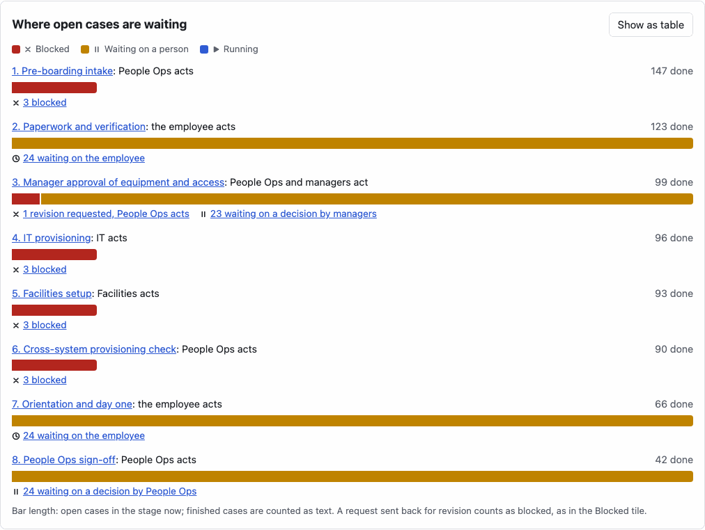
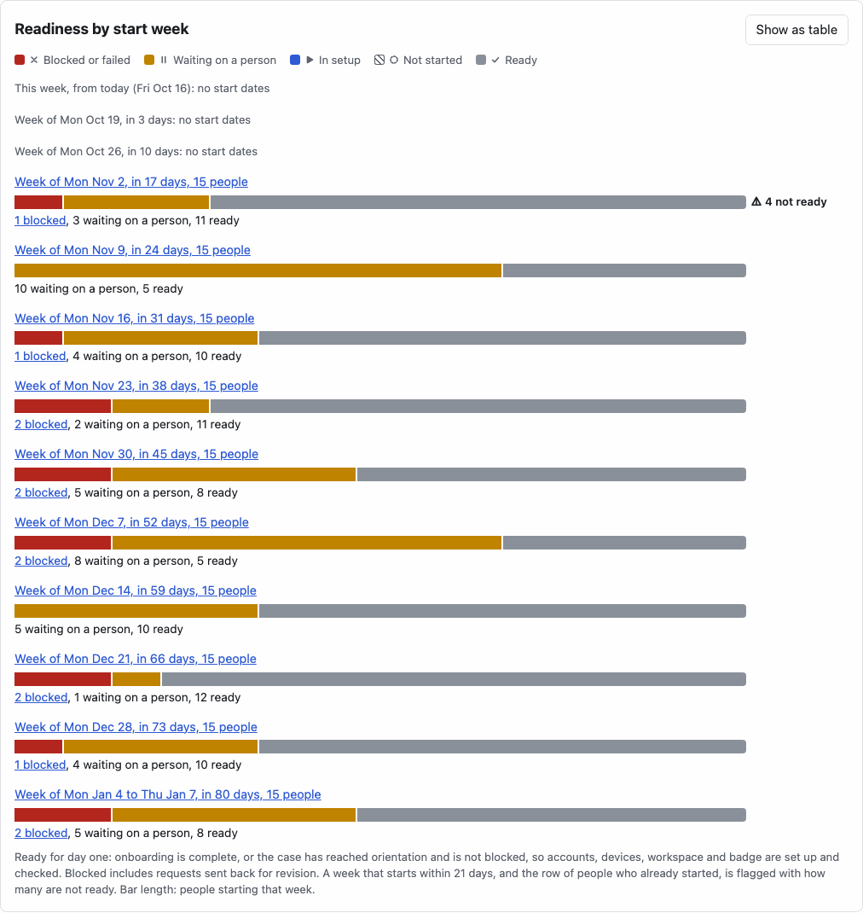
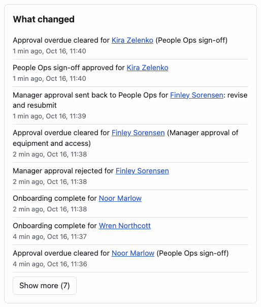
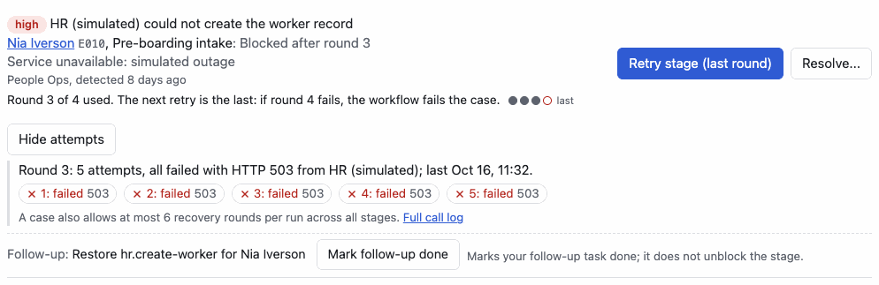
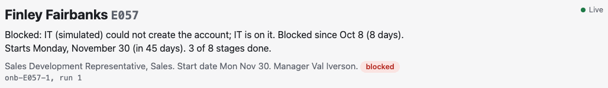
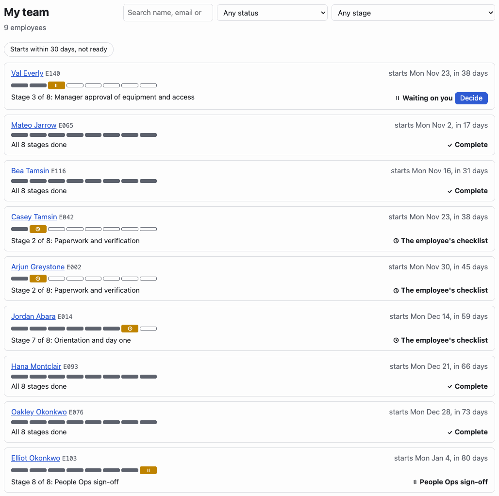
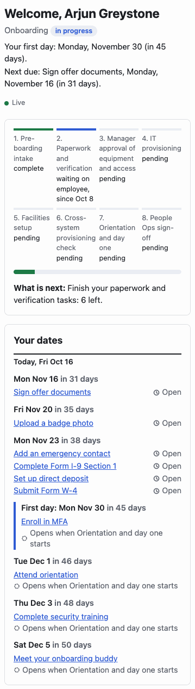
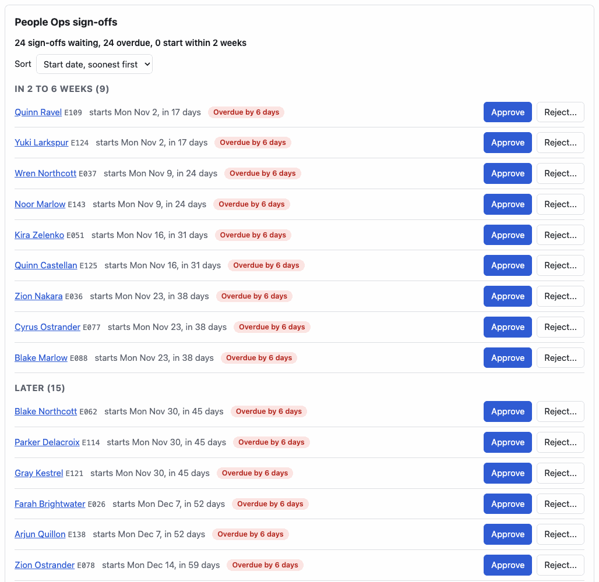

# User workflows

How each persona moves through OnboardFlow, as the app works now. All people are synthetic, and HR, IT and Facilities are simulated systems. Roles and permissions are in [`src/shared/roles.ts`](../src/shared/roles.ts); the terms are in [CONTEXT.md](../CONTEXT.md).

Every page follows the same rules:

- An action's result appears inside the row or card where it was started: a short confirmation, or an error that says what happened and what to do next, with the request id. Only that row's button waits while its request is in flight. Confirmations are also announced to screen readers.
- Keyboard focus follows the action. A button whose request is in flight is marked unavailable but keeps focus, so after a failure Enter tries again. When an action removes its button (a decided approval, a task marked done), focus moves to the result or to the next step; Cancel returns focus to the button that opened the step; when an item leaves a list (a resolved blocker), focus moves to the item that took its place.
- A repeated button's accessible name starts with its visible text and then names its subject ("Retry stage: IT provisioning for Avery Abara", "Retry running: ..."), so screen readers say what the button shows and speech input matches it.
- If a request's outcome is unknown (the connection dropped, or the answer could not be read), the message says so, and clicking again is safe: it is sent with the same Idempotency-Key, so the server answers with the stored result instead of acting twice.
- A page that cannot load says why: "No case E999" with a link back, a 403 explained for the role, or the failure with Try again. A failed background refresh keeps the earlier data on screen with a warning.
- Lists keep their filters in the URL (Cases, Queue, Audit, and the Integrations window and case id), so reload, Back and shared links show the same view.
- The first Tab stop is "Skip to content"; after a navigation, focus moves to the page heading, and each page has its own tab title, including a page the role cannot open ("Approvals are handled by managers and People Ops." under the heading Approvals).

## Signing in (everyone)

Local development:

1. Open any page, for example a case link. Signed out, you land on the login page, which remembers where you were going.
2. Choose a persona. You return to the page you asked for, if your role can open it, or to your home page.
3. To act as someone else, use **Switch persona** in the sidebar. It signs you out and clears everything the previous persona loaded.
4. If the session ends while you work, a banner says "Your session ended" with a link that signs you in and returns you to the same page.
5. If OnboardFlow cannot tell who is signed in (a server error or no connection), the page says so with **Try again** and stays on the same URL; only a signed-out answer leads to the login page.

Production (behind Cloudflare Access): Access signs you in with a one-time PIN. **Sign out** is in the sidebar. An Access account that has no OnboardFlow user sees that, and is told to ask an admin. When the Access session ends, Access answers the app's requests with a redirect to its sign-in; the app treats that as an ended session and the banner offers **Reload to sign in**, which goes back through the Access sign-in. The login page behind Access offers the same reload. This path is tested with mocks only, not through a real Access session.

## Employee (new hire)

Home: **My onboarding** (`/me`).

1. Under the welcome, read your first day and what is due next: "Your first day: Monday, November 30 (in 45 days)." and "Next due: Sign offer documents, Monday, November 16 (in 31 days)." Overdue tasks come first ("2 tasks overdue; the oldest is ..."). Before People Ops starts your onboarding, the page says your tasks appear once it does.
2. Read the stage stepper (the current stage says since when), the progress bar (stages complete out of 8) and **What is next**, which also says how many tasks are overdue.
3. **Your dates** lists every task date in order, grouped by day, with your first day as a milestone holding the tasks due that day, and a Today line between past and future dates. Each task says its state in words (Done, Overdue, Open, or "Opens when Orientation and day one starts"); its link moves focus to that task in the checklist below.
4. Read **Updates on your onboarding** if it appears: plain notices such as "Your manager's approval is taking longer than planned. People Operations is following up. Nothing is needed from you." or "We hit a setup problem with IT (a simulated system). The IT team is fixing it."
5. Work the checklist of the current stage: **Mark done** on each task. The task turns done only once the server confirms, and the row says "Marked done: Submit Form W-4"; if it fails, the row says why, the task stays open and the button keeps focus, so Enter tries again as the same action.
6. Tasks of a stage that has not started show **Not open yet** and when they open. Tasks past their due date show **Overdue**.
7. The page updates by itself when the case moves on (the live indicator shows the connection).

## Manager (hiring manager)

Home: **Approvals** (`/approvals`).

1. Each pending card shows the request (equipment profile, license bundle, privileged access, work mode, site, start date), the SLA ("Due in 5 h", "Due in 3 days", "Overdue by 2 days"), a link to the case, and for a second round the first round's rejection reason and the note People Ops sent with the resubmission.
2. If privileged access was requested, choose **Grant privileged access** or **Approve without privileged access**. Approve stays disabled until one is chosen.
3. **Approve**, or type a reason and **Reject**. The card confirms ("Approved. IT provisioning starts next.") and stays on screen, showing the decided status and no SLA; focus moves to the confirmation.
4. If another tab or person already decided, the card says "Already decided. Nothing more to do." and shows no status or SLA, since the outcome is not known there.
5. The list refreshes when you come back to the window.
6. **My team** (`/cases`) shows one row per direct report: the name (linked to the case), "starts Mon Nov 23, in 38 days", an 8-step strip of the stages, "Stage 3 of 8: Manager approval of equipment and access" and who acts now. A report waiting on your own decision reads **Waiting on you** with a **Decide** link to that card in Approvals, and comes first; the rest follow by start date. Other rows say "People Ops sign-off", "Revision requested: People Ops revises and resubmits", "Blocked: IT on it" (the department that owns the blocker the stage is blocked by, the one its case page names), "The employee's checklist", "Running (automated)", "Complete" or "Not started: People Ops starts it". **Starts within 30 days, not ready** narrows the list (kept in the URL); search and the status and stage filters still work. If your pending approvals cannot load, rows say "Waiting on a decision" and a note says why.
7. A case page is read-only for you. Its first sentence says what the case waits on: "Waiting on you to decide the equipment and access request." with **Decide in Approvals**, or after a rejection "Waiting on People Ops to revise and resubmit ...". Opening a case outside your team explains that it is not one of your direct reports.

## People Ops coordinator

Home: **Queue** (`/queue`).

1. The queue lists each open People Ops blocker once, highest severity and oldest first. Each item has a plain title ("Manager approval overdue", "Cost center rejected by HR"), the employee linked to the case, the stage's state ("Blocked after round 2"), the age, and the follow-up task the agents created.
2. Narrow it with the kind chips (kept in the URL, for example `/queue?kind=approval_overdue`). The list refreshes by itself when a case changes.
3. Act on the item, by kind:
   - **Approval rejected**: **Resubmit in Approvals** opens the card, scrolled into view and focused. Write what changed and **Resubmit**; the card confirms "Resubmitted: round 2 sent for approval". The agents close the blocker on resubmit.
   - **Cost center rejected by HR**: the item shows what HR (simulated) rejected and the current value. Type a cost center in the `CC-` plus 4 digits form; **Fix cost center** is enabled only for a valid, different value. After "Saved", focus moves to **Retry Pre-boarding intake now**. Before the fix, Retry is a secondary button that warns the retry would fail again and use the stage's next recovery round ("uses round 2 of 4").
   - **HR outage**: **Retry stage**. Above it the item says how many recovery rounds the stage has used: "Round 1 of 4 used on this stage. At most 3 more retries: if round 4 fails, the workflow fails the case." (with a dot per round). When one retry is left, the button reads **Retry stage (last round)**. **Show attempts** loads the case's call log only when opened and sums up the latest round ("Round 3: 5 attempts, all failed with HTTP 503 from HR (simulated)"), with each attempt as a word and a link to the full call log. While the retry runs, the button reads "Retry running" and the item shows the new round. If the retry after an outage hit a rejected value, the agents leave the outage blocker open beside the new data issue; the outage item then offers no Retry, says the stage is blocked on that value, and **Go to the cost center fix** moves focus to the data issue's item (or, when a kind filter hides it, **Fix it on the case page** opens the case).
   - **Manager approval overdue**: waiting on the hiring manager; the case link shows the details.
   - **Sign-off overdue**: **Decide in Approvals** opens that sign-off's row, scrolled into view and focused.
   - **Checklist tasks overdue**: the case link shows which tasks.
4. **Resolve...** closes a blocker by hand: it asks for a reason and warns that the agents reopen a blocker whose condition still holds. Cancel returns focus to **Resolve...**; once the blocker resolves, its item leaves the list and focus moves to the next item.
5. **Mark follow-up done** completes the follow-up task; it does not unblock the stage. The follow-up line and its confirmation stay in the item.
6. Start onboarding from **Cases**: find the employee (search waits until you stop typing; filters stay in the URL; **Load more** shows the next 100) and click **Start onboarding for <name>**. The status filter also offers **Open (started, not finished)**.
7. **Approvals**: sign-offs are compact rows under a summary line ("24 sign-offs waiting, 24 overdue, 0 start within 2 weeks"), sorted by start date and grouped (Already started, Starts within 2 weeks, In 2 to 6 weeks, Later); the sort can also be most overdue or name, kept in the URL. Each row has the name, "starts Mon Nov 2, in 17 days", the SLA, **Approve**, and **Reject...**, which asks for a reason before **Reject sign-off** is enabled. A decided row stays with its confirmation, which takes focus. Resubmit rejected requests under **Revision requested**.
8. A case page's first sentence says what the case waits on, who acts, since when, the start date in words and how many stages are done ("Blocked: HR (simulated) could not check the worker record; People Ops is on it. Blocked since Oct 8 (8 days). Starts Monday, December 7 (in 52 days). 5 of 8 stages done."). For a sign-off or a revision it offers **Open in Approvals**. A blocked stage there shows the same rounds readout and Show attempts as the queue.
9. **Dashboard**: **Where open cases are waiting** draws each stage's open cases (blocked, waiting on a person, running) on one shared scale, says who acts (for blocked cases, the departments that own their blockers, as their case pages say), counts finished cases as text, and links every count to the matching cases; a request sent back for revision counts as blocked, as in the Blocked tile. **Show as table** gives the same numbers as a table. **Readiness by start week** shows who starts each week, counted from your calendar date, and whether they will be set up by their first day; a week within 21 days with anyone not ready is flagged ("4 not ready"), in the table view too, and the counts open the matching lists (for example the blocked people starting the week of Nov 2). The current week counts only from today ("This week, from today (Fri Oct 16)") and the last only to the window's end ("Week of Mon Jan 4 to Thu Jan 7"), and their links cover the same days. **What changed** lists the latest case events as sentences ("Pre-boarding intake blocked for Nia Iverson: HR (simulated) could not create the worker record"). The tiles link to the matching cases. Blocker counts cover every department, and the table says so: a coordinator's kind rows link to their queue only for kinds that are all their department's (for People Ops, the approval and checklist kinds). If live updates pause, the page says since when and offers **Refresh**, and the charts keep their last frame, dimmed.

## IT coordinator

Home: **Queue**, showing IT's blockers.

1. **IT outage** (for example the simulated IT system could not create the account): read how many rounds are used ("Round 1 of 4 used on this stage ..."), open **Show attempts** if you need the calls, then **Retry stage** and watch the item move to "Retry running, round N".
2. **License bundle rejected by IT**: choose a bundle from the list, which offers only the bundles IT (simulated) accepts for the employee's employment type, then **Fix license bundle**; the choice clears and focus moves to **Retry IT provisioning now**. An IT outage item on the same stage points to this fix instead of offering Retry.
3. **Device order stalled**: **Retry stage**.
4. On a case page, a blocked IT stage shows the same guided fix and Retry.
5. **Integrations** shows each simulated system's health over a time window, and a case's call log (every attempt, outcome, latency and key); the window and the case id stay in the URL. An unknown case id says "No case E999".
6. Approvals are not an IT task; opening `/approvals` shows the heading Approvals and says "Approvals are handled by managers and People Ops."

## Facilities coordinator

Home: **Queue**, showing Facilities' blockers.

1. **Facilities outage** (workspace or badge): **Retry stage**.
2. **Badge photo missing**: **Mark photo on file**, which then reads "Photo on file" and moves focus to **Retry Facilities setup now**. A Facilities outage item on the same stage points to this fix instead of offering Retry.
3. Cases, Dashboard and Integrations work as for IT; Readiness by start week shows who starts soon and still needs a workspace or badge.

## Admin

Home: **Dashboard**.

1. Read the totals, **Where open cases are waiting** (which stage holds open cases and who acts), **Readiness by start week** and **What changed**; click a number to open the matching cases or queue (department and kind rows link to the queue with that filter).
2. **Queue** covers every department; the department select narrows it (kept in the URL). An overdue manager approval offers **Decide on behalf**.
3. **Approvals**: two sections, **Manager approvals** as cards (each says "on behalf of the hiring manager (M01)") and **People Ops sign-offs** as rows under one notice that the admin decides them on behalf of People Ops, which every row's buttons point to; the decision is audited.
4. On a case page, **Admin controls** restart or terminate the workflow: type a reason of at least 10 characters, click the button, and confirm in the step that names the employee, the effect and the reason ("Restart Avery Abara's workflow as run 2? Reason: ..."). Focus moves to that prompt; while it is open the reason is read-only ("Cancel to change it"), and Cancel returns focus to the button. Terminate is offered only for a started case that has not ended; otherwise the page says why. The step stays open until the server answers; then the result ("Restarted: run 2") appears in place with focus, and the reason clears.
5. **Audit** lists every user, agent and workflow action, filterable by action, actor and case (kept in the URL; the typed filters wait until you stop typing).

## Changed on 2026-10-15

What this round improved, and why:

1. **Feedback where the user acted.** Errors used to stack at the bottom of each page, a plain-text 500 surfaced as a JSON parser error, and one Retry in flight disabled every row. Each row and card now owns its action: pending, the error (with a next step and the request id) and the confirmation stay in that item, and successes are announced. A dropped connection or an unreadable answer counts as an unknown outcome, so the next click reuses the Idempotency-Key instead of risking a second execution. Repeated buttons name their subject ("Start onboarding for Wren Abara").
2. **Guided data-issue fix.** A free-text field accepted any value next to a primary Retry, and every wrong value plus Retry spent one of the stage's recovery rounds (the workflow fails the case when they run out). The fix now shows what was rejected and the current value, accepts only values the simulated system takes, and offers Retry as the main action only after the fix. The API is unchanged, so eval scenario R09 still sends an invalid cost center over the API.
3. **The queue as one item per blocker.** Blockers and their follow-ups were two unlinked lists, so each blocker showed up twice, titled by raw ids, with no case link, a Resolve that sent a fixed reason, and no refresh. Each blocker is now one item with its follow-up, a plain title, a case link, the stage's state and the right next action, with filters in the URL, Load more, a Resolve that asks for a reason, and a refresh when the ops hub publishes a new version.
4. **Page-level loading and errors.** A 403 or 404 was retried three times (about 7 s of "Loading case...") and then shown as "Could not load this case."; a failed list showed an empty table. 4xx answers are no longer retried, and each page explains 404, 403 and failures with Try again.
5. **Sign-in, sessions and the shell.** Signing in always went to the home page, there was no sign-out or persona switch, an expired session showed up only as failing actions, and the shell had no skip link, page titles or focus handling. All of these now exist, and the `next` parameter accepts only safe same-site paths.
6. **Phone layouts.** The main column grew to the width of the widest table, so pages scrolled sideways at 375 px, and the funnel's labels rendered at about 6 px. The layout now fits a 375 px screen: lists stack, the cases table becomes cards, wide tables scroll inside their card, and the funnel is HTML with real text.
7. **Approval cards.** Approving without noticing the privileged-access checkbox silently declined it. The choice is now explicit, and cards show readable fields, the SLA in days, round history, a case link, the admin's on-behalf line and their own outcome.
8. **Employee portal in plain language.** New hires saw the staff blocker list ("Subject: apr:E003:manager_approval:1"). They now see plain notices, overdue tasks are marked and counted, and tasks of a stage that has not started say "Not open yet".
9. **Cases and dashboard.** Employees after the first 100 were reachable only by search, filters were lost on reload, and every keystroke sent a request. Cases now page with Load more, keep filters in the URL and wait for typing to stop. The dashboard's numbers link to the lists behind them, and a paused live connection is explained, with a manual Refresh instead of polling.
10. **Safer restart and terminate.** Terminate ran in one click with any reason, including on cases the server would refuse. Both now need a 10-character reason and a confirm step, are offered only where the server would accept them, and confirm the result.

## Changed on 2026-10-16

A review of the 2026-10-15 round found places where the workflows above were not yet true. What changed, and why:

1. **No Retry on an outage that now waits on a data fix.** When the retry after an outage hit a rejected value, the agents left the outage blocker open beside the new data issue, and the queue showed that stale item with a primary Retry stage, with no warning. Each click spent a recovery round on the unfixed value, so two could fail the case. The outage item now points to the data issue's guided fix instead, as the case page already did.
2. **Focus follows the action.** Focus moved only on navigation; pressing Approve, Mark done, Cancel or a confirm step's buttons left it on `<body>` (Chromium moves focus there when a focused button turns disabled). Buttons stay focusable while their request runs, results and next steps take focus, Cancel returns it, and focus moves on when an item leaves a list. Mark done no longer changes the row before the server answers, so a failure leaves the same button focused for Enter.
3. **Accessible names start with the visible text.** "Retry stage" and "Retry running" had the same name, so screen readers never said a retry was running, and speech-input users could not say the visible label.
4. **A failed `/api/me` no longer signs the user out.** One 503 or dropped connection sent a signed-in user to the login page, which behind Access had no button and no reason. The page now explains and offers Try again.
5. **Decided approval cards show the decision.** The card kept on screen still said "pending" and "Overdue by 6 days" above "Approved."
6. **The admin confirm step holds what it confirms.** The reason stayed editable while the step was open, so Confirm could send a 1-character reason; the restart prompt did not name the employee.
7. **Dashboard numbers open lists that match them.** The sign-off funnel row (24) opened a list of 66 that included every completed case, and an IT coordinator's "approval overdue 48" opened an empty queue. The employees list gained a read-only `status=open` filter for the funnel's links.
8. **Smaller fixes.** The license bundle choice clears after a save (it could be sent again); stacked phone cards keep ids and second lines in the value column, and badges keep their width; a data issue's rejection reads once and in words; Audit and Integrations keep their filters in the URL; a page a role cannot open has its own heading and tab title; an Access redirect counts as an ended session.

## Changed on 2026-10-16: views for each persona's question

A UI and data visualization pass. Each view below answers a question one persona has, and was checked in a browser against the local demo state (`npm run demo:drive`, then `wrangler dev` on the real clock, 2026-10-16). Every chart gives its numbers as text next to the bars, gives each state an icon and a word as well as a color, has a table or text alternative, and fits a 375 px screen in light and dark. The pictures are at 1280 px in the light theme; each has dark and 375 px versions in [screenshots/](screenshots/).

1. **Where open cases are waiting** (admin and coordinators: which stage holds work, and whose move is it?). The funnel drew each stage as a share of all 150 started cases, so finished cases filled most of every row and the 3 blocked cases at each automated stage were slivers; its legend called a revision at a checkpoint "waiting on employee". Each row now draws only the stage's open cases (blocked, waiting on a person, running) against the busiest stage, so 3 blocked cases are an eighth of the 24 at paperwork. It says who acts (for blocked cases, the departments that own their blockers, as their case pages say; the employee; managers; or People Ops for a sign-off or a revision: "1 revision requested, People Ops acts", which counts as blocked, as in the Blocked tile), counts finished cases as text, and links every count to the matching cases. **Show as table** swaps in a captioned table.
   
   Also: [1280 dark](screenshots/dashboard-stages-1280-dark.png), [375 light](screenshots/dashboard-stages-375-light.png), [375 dark](screenshots/dashboard-stages-375-dark.png).
2. **Readiness by start week** (People Ops, IT, Facilities and the admin: who starts soon and will not be set up by their first day?). No screen grouped people by start date. A new read-only endpoint, `GET /api/dashboard/start-readiness`, counts the people starting each week from the viewer's calendar date by readiness: ready (complete, or at orientation or later and not blocked), blocked or failed, waiting on a person, in setup, not started. Each week is a bar on one scale with its counts as text; a week within 21 days with anyone not ready gets a "4 not ready" flag. The week's label opens everyone starting that week, and the blocked, not started and failed counts open exactly those people (`/cases?status=blocked&startFrom=2026-11-02&startTo=2026-11-08`, shown as a removable "Start week of Mon Nov 2" filter).
   
   Also: [1280 dark](screenshots/dashboard-readiness-1280-dark.png), [375 light](screenshots/dashboard-readiness-375-light.png), [375 dark](screenshots/dashboard-readiness-375-dark.png).
3. **What changed** (the admin's home page: what just happened?). Recent activity printed action codes, employee ids and actor ids, mostly integration calls and provisioning polls. `GET /api/dashboard/changes` reads the latest case events of ten actions and the card says each one as a sentence with the name linked to the case. It carries no rejection reasons, notes or email addresses, and refreshes when a case changes, at most once a minute.
   
   Also: [1280 dark](screenshots/dashboard-changes-1280-dark.png), [375 light](screenshots/dashboard-changes-375-light.png), [375 dark](screenshots/dashboard-changes-375-dark.png).
4. **Rounds next to Retry** (coordinators: what does this Retry cost?). The queue said "Blocked after round 1" and never the limit, while each Retry of a stage still blocked on the same cause uses one of its 4 rounds and the workflow fails the case when round 4 fails. Outage and stall items, the guided data fix and a case page's blocked stages now say "Round 3 of 4 used. The next retry is the last: if round 4 fails, the workflow fails the case.", the last Retry reads **Retry stage (last round)**, and **Show attempts** shows the latest round's calls only when asked. The pictures show the item after two retries in the demo, and [the first round](screenshots/queue-rounds-1280-light.png).
   
   Also: [1280 dark](screenshots/queue-rounds-last-1280-dark.png), [375 light](screenshots/queue-rounds-last-375-light.png), [375 dark](screenshots/queue-rounds-last-375-dark.png).
5. **The case page's first sentence** (managers, coordinators, admin: what is this case waiting on, and who acts?). The header showed a status badge and "Starts 2026-11-30"; who had to act appeared only in blocker text further down.
   
   Also: [1280 dark](screenshots/case-sentence-1280-dark.png), [375 light](screenshots/case-sentence-375-light.png), [375 dark](screenshots/case-sentence-375-dark.png), and the manager's view with **Decide in Approvals**: [1280 light](screenshots/case-sentence-manager-1280-light.png), [375 dark](screenshots/case-sentence-manager-375-dark.png).
6. **My team** (managers: who is waiting on me, and who starts soon?). The page printed raw stage ids and ISO dates and gave the same "awaiting approval" badge to a report waiting on the manager and to one waiting on People Ops.
   
   Also: [1280 dark](screenshots/my-team-1280-dark.png), [375 light](screenshots/my-team-375-light.png), [375 dark](screenshots/my-team-375-dark.png).
7. **Your dates** (the new hire, often on a phone: when is my first day, and what is due when?). `/me` never showed the start date and listed tasks by stage only.
   
   Also: [375 dark](screenshots/my-dates-375-dark.png), [1280 light](screenshots/my-dates-1280-light.png), [1280 dark](screenshots/my-dates-1280-dark.png).
8. **Sign-offs as rows** (People Ops and admins: whose sign-off matters first?). 24 identical closeout cards in approval-id order made the page 6,869 px tall at 1280 px on the demo state, and nothing said how many were waiting or whose start date was soonest. As rows under a summary, sorted and grouped by start date, the same page is 1,625 px.
   
   Also: [1280 dark](screenshots/approvals-signoffs-1280-dark.png), [375 light](screenshots/approvals-signoffs-375-light.png), [375 dark](screenshots/approvals-signoffs-375-dark.png).
9. **Found in the browser check and fixed.** Approving a sign-off left its row without the confirmation and dropped focus to the page, because the list refetched without the decided item before the decision's answer was handled; cards and rows now stay on screen from the moment they are decided. On a phone, the readiness bars used about 60% of the card (they kept room for the flag) and the attempt chips stacked into tall pills; the bars now take the full width with the flag beside the week's label, and each chip keeps one line.

## Changed on 2026-10-16: review fixes for the views

A review of the views above found six places where they disagreed with another screen or left something out. What changed, and why:

1. **Who acts on a blocked case is one answer on every screen.** At the cross-system provisioning check the dashboard said "People Ops, IT or Facilities acts" and My team "Blocked: People Ops, IT or Facilities on it", from the three systems the stage calls, while the case page named the one department that owns the open blocker. On the demo all three cases there wait on an HR outage, so an IT or Facilities coordinator told to act found nothing in their queue. The dashboard, My team and the case page now all name the owner of the blocker the stage is blocked by ("6. Cross-system provisioning check: People Ops acts"). Only while a blocked case has no open blocker yet do they name the stage's owners.
2. **A request sent back for revision is blocked on both charts.** The stage chart drew it as waiting on a person, while the readiness chart beside it, the Blocked tile and the blocked case list count it as blocked. It is now drawn and marked as blocked, with the same words ("1 revision requested, People Ops acts"), so the chart's blocked counts add up to the Blocked tile.
3. **Readiness counts from your date.** The card counted days, and told "already started" from "this week", on the server's UTC date, while the case page, My team and Approvals count from yours, so for part of every day it was a day off from every other screen (from 17:00 in California). It now counts from your calendar date.
4. **A partial week links to the days it counts.** The current week counts only from today and the last only up to the window's end, but both linked Monday to Sunday, so a link could list people its number left out. They now say so and link to those days.
5. **The two table buttons say which chart they swap** ("Show as table: Readiness by start week"), and each card is named by its heading, so a screen reader tells them apart.
6. **The readiness table keeps the flag.** The table view left out "4 not ready" and still described bar length; the flag is now in the week's row header, and the caption fits each view.
